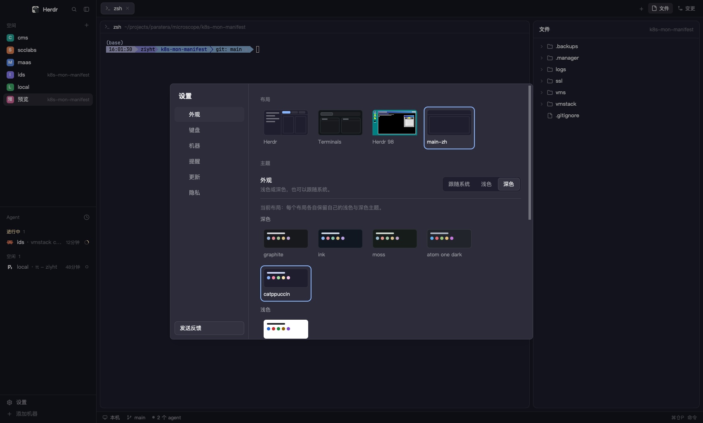

# herdr-hanfang(汉坊)

中文的 Herdr 桌面工作台:main 布局的骨架 + 社区最强 mod 组合
(better-sidebar / better-tabs / better-changes / herdr-nvim / branch-pr /
branch-issue / better-files)+ 自制紧凑侧栏「空间轨道」(hanfang-spaces)+
全套中文界面。基于 **Herdr 0.1.16**。
复刻说明见 [RECIPE.md](RECIPE.md)。



## 安装

```sh
git clone https://github.com/ziyht/herdr-hanfang.git
cd herdr-hanfang
./install.sh
```

安装器采用**符号链接架构:仓库即现场**——汉坊自有件(布局、hanfang-*/-zh mod、
programs.json、my-icons、主题)以符号链接接入 `~/.config/herdr-app/`,现场热编辑
就是改仓库文件(git status 即时可见,不再有"两边同步"问题);社区 mod(better-*/
branch-*/herdr-nvim*)保持拷贝并自动跑 zh-mods-patch 字典汉化;最后逐 mod check
验收并切换布局。幂等,重复运行只修复缺失与断链,现场独立新内容先回写仓库再链。

`programs.json` 覆盖 Codex 的图标为单色 OpenAI 标(随状态着色,与其它 agent 一致);
不复制也不影响其它功能,只是 Codex 显示为默认的多色图标。

可选主题:`cp themes/catppuccin.json ~/.config/herdr-app/themes/`
然后 `herdr-app do app.theme --name catppuccin`。

可选:Hermes agent 集成(图标/状态/上下文用量)。上述 mod 已内置支持,
但需要 hermes 侧的状态桥(见下方「第四步」与 `hermes-bridge/` 目录)才能
拿到状态与 token 数据;不装则 hermes 终端仅显示为普通图标。

可选键位(herdr-nvim,合并进 keys.json 的 global 段,勿整份覆盖):

```json
"cmd-e": "mod.open:herdr-nvim",
"cmd-o": "herdr-nvim.pick",
"cmd-shift-e": "herdr-nvim.reveal"
```

⌘P 指向中文 picker(`"cmd-p": "mod.open:picker-zh"`)由 install.sh 第 3 步自动合并:
已指向 `picker-zh` 时跳过,是 Herdr 默认的 `mod.open:picker` 就替换,其它自定义绑定不覆盖。
注意 keys.json 一旦被改过就是用户自有文件,升级不再补默认键位。

⌘+点击终端里的文件路径(`mods/hanfang-links`,0.1.17+ 的 link_handlers)交给 herdr-nvim,
在**点击处所在标签页**的 nvim 里打开并跳到行号(`file.rs:42`、`:5-12`、`#L5-L12` 都取首行);
规则只认源码类扩展名,路径为空(远程/未解析)、点击在别的机器上、或 herdr-nvim 拉不起 nvim 时
一律交回 Herdr 原生打开方式。布局 root 的 `"link_handlers": ["hanfang-links"]` 决定顺序。

运行依赖(缺失只影响对应面板):Neovim(文件面板)、
GitHub CLI(branch-pr)、`LINEARAPIKEY` 环境变量(branch-issue)。

不需要改 Herdr.app 本体。

以上完成后,窗口框架(侧栏、标签栏、右键菜单、通知)即为中文。继续两步得到完整中文:

**第二步(社区面板中文化)已并入 install.sh**——安装器自动拷入 zh-mods-patch
并对社区 mod 跑字典汉化(幂等,pristine/ 快照自动生成,`--restore` 可还原)。
需要手工重跑时:`~/.config/herdr-app/zh-mods-patch/apply.sh`。

**第三步(可选):原生界面中文化**——设置页、命令面板、欢迎页等,
见下节 zh-patch。

**第四步(可选,本机跑 Hermes 则推荐):Hermes agent 集成**

让 Herdr 把 hermes 终端识别为一等 agent:专属图标、真实状态(干活/
完成/需要你)、上下文 token 用量与进度条。mod 侧已随第一步装好;
hermes 侧的状态桥是**独立三件套——不随汉坊包安装、不随 ~/.hermes
数据迁移,换新机必查**(2026-11-23 换机漏装实录):

```sh
cd hermes-bridge && ./install.sh   # ①hook 脚本 + ②六事件注册 + 一次性授权
```

③ launcher 自报段:install.sh 之后按 `hermes-bridge/README.md`
「可选:启动自报」给 `~/.local/bin/hermes` 补上;hermes 升级会重新
生成 launcher,届时需重加。

> 给安装代理:本步**先检测、必询问**。检测三项:
> `ls ~/.hermes/agent-hooks/herdr-status.py`、
> `hermes hooks list | grep herdr`、`grep 7501 ~/.local/bin/hermes`。
> 有缺项时向用户说明「未装则 hermes 终端只显示普通图标;安装会写
> ~/.hermes/config.yaml 的 hooks 注册并跑一次授权」,由用户选择装或
> 不装;三项齐全则跳过。不得当作普通可选依赖默默略过。

> 给安装代理:zh-mods-patch 按字典就地修改已安装社区 mod 的文案
> (幂等,pristine/ 快照自动生成,`--restore` 可还原);zh-patch 会原地替换
> 并锁定应用自带的 9 个界面文件,执行前先 `herdr-app --version` 确认目标机
> 是 0.1.16(译文按此版本逐行对齐),并向用户说明操作与回滚方式。

## 可选:原生界面中文化(zh-patch)

`zh-patch/` 把设置页、命令面板、欢迎页、更新内容、反馈,以及
confirm(关闭确认)、prompt(重命名)、peek(偷看)、help(快捷键)
九个「应用每次启动会重写」的文件原地中文化并加文件锁:

```sh
cp -R zh-patch ~/.config/herdr-app/
~/.config/herdr-app/zh-patch/apply.sh          # 应用中文并锁定
osascript -e 'quit app "Herdr"'; sleep 3; open -a Herdr
```

执行时机:装包后跑一次并重启即可;文件锁跨 Herdr 重启、跨系统重启一直有效,
日常使用无需再跑。唯一需要重跑的时机是 Herdr 升级后——不跑的后果是设置页
等界面保持中文但停留在当前版本,新版新增的选项不会出现(不会崩溃)。
`apply.sh --status` 随时查看九个文件的锁定状态,`--restore` 一键回滚英文。
译文与 0.1.16 源码逐行对齐,升级后需重新移植再 apply。

## 升级

Herdr 升级后,把每个 `mods/<name>-zh` 与新版 `mods/<name>` 逐对 diff,
把功能差异移植进 -zh 版本(保留中文文案);`mod.json` 的
`cloned_from.version` 记录当前同步基线。zh-patch 同理
(`--restore` → 升级 → 移植 → `apply.sh`)。

## 语言说明

窗口框架、终端右键菜单、通知、状态栏、工作树对话框、设置页(zh-patch)为中文;
better-* 与 branch-* 社区面板为英文原版。品牌「Herdr」、术语 agent、
键名 Esc、主题名有意保留英文。macOS 菜单栏菜单项与应用自身 toast
在二进制里,无法翻译。

## 致谢与许可

- Apache-2.0,见 [LICENSE](LICENSE)、[NOTICE](NOTICE)
- better-sidebar / better-tabs / better-changes / better-files /
  branch-pr / branch-issue 来自 [munza/herdr-mods](https://github.com/munza/herdr-mods)(Apache-2.0)
- herdr-nvim / herdr-nvim-header 来自 [ChmaraX/herdr-nvim](https://github.com/ChmaraX/herdr-nvim)(MIT,header 有本地修改)
- `mods/*-zh` 与 `zh-patch/` 基于 Herdr 自带 mod 与 frame 源码翻译;
  zh-patch 部分译文借自 [yzj160212/herdr-zh](https://github.com/yzj160212/herdr-zh)(Apache-2.0)
- 图标来自 [Lucide](https://lucide.dev)(ISC);主题配色 Catppuccin Mocha
