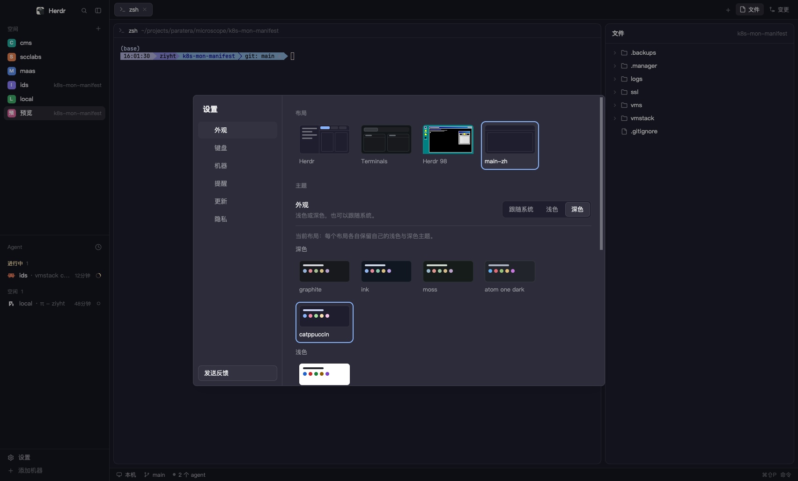

# Herdr 简体中文

Herdr 桌面版自带 main 布局的完整简体中文版:结构、尺寸、行为与原版逐行一致,
只是所有写死在界面模块里的英文文案换成了简体中文。跟随 Herdr 0.1.16,
每次 Herdr 升级后按「升级」一节同步。

## 你会看到什么

- 左侧 268px 侧栏(深色 chrome 底,可拖宽/折叠):顶部品牌行(Herdr 标志、
  搜索按钮、侧栏开关),中间空间列表——本机空间在前、每台远程机器一组、
  仓库的 worktree 空间嵌套在所属仓库下,每组带 + 新建按钮;下半部 agent
  列表,可按优先级或按空间分组;底部「设置」「添加机器」两行
- 顶部 42px 标签栏:标签胶囊(带状态点或转圈)、+ 菜单、「文件」「变更」
  面板开关、窗口按钮(macOS 让位红绿灯)
- 中央终端:10px 圆角卡片、1px 边框(聚焦时 accent 色)、8px 间距;
  每个窗格 30px 表头——程序图标、名称或 agent 会话标题、路径、状态徽章、
  分屏/缩放/关闭按钮
- 右侧 368px 可隐藏面板:文件树(点开文件只读预览、语法高亮)/
  Git 变更(文件列表、diff、提交框、「提交」按钮)
- 底部 28px 状态栏:本机或机器名、当前分支、「N 个 agent」「N 个需要你」、
  命令面板快捷键提示
- 主题跟随用户设置(截图使用附带的 Catppuccin Mocha,可选)

## 行为

- agent 四种状态:working 转圈;blocked 红底「需要你」徽章;
  done 绿点;idle 空心圈。置顶的 agent 固定在列表顶部
- 右键终端内容:中文菜单(向右/向下分屏、缩放窗格、关闭窗格、
  右键交给程序);右键标签:重命名/新建标签页/关闭;
  右键空间:重命名/新建·打开·移除工作树/关闭
- + 菜单:终端、已安装 agent(数字键 1-9 快捷启动、未安装的标注
  「未安装」)、新建空间、新建/打开工作树
- 侧栏搜索按钮:「跳转到…」面板,列空间、标签和其中的 agent,可输入过滤
- 通知条中文:agent 完成/需要你时弹出;机器需要登录时显示
  「需要登录:运行 …」并带「复制」按钮
- 「添加机器」对话框:ssh 配置主机列表、连接状态(已添加/连接中)、
  登录指引、远程 Linux 的断连警告卡片
- 工作树对话框:分支筛选、主检出/已打开标记、非拉丁分支名
  (中文、emoji)独立文件夹、移除时的未提交变更警告

## 构成

- 布局树:`root row [sidebar column(brand 46px → workspace-chrome-zh /
  spaces weight 1 → spaces-zh / agents weight 1 → agents-zh /
  footer 69px → workspace-chrome-zh), work column(tabs 42px → tabs-zh /
  work-body row(main: tab active + pane 头 pane-zh / panel stack 368px
  hidden: files-zh + changes-zh) / status 28px → workspace-status-zh)]`;
  根字段:`titlebar: none`、`traffic_lights: [12,16]`、
  `toast: "toast-zh"`、`terminal_menu: "menu-zh"`
- 14 个 mod 克隆(mods/*-zh,mod.json 记录 cloned_from 版本 0.1.16):
  workspace-chrome-zh(品牌行/底栏/全部共享图标 31 个 SVG)、
  spaces-zh(空间列表、机器分组、git 状态、断连警告)、agents-zh、
  tabs-zh(含 0.1.16 的滚轮手势与会话标题标签)、pane-zh、files-zh、
  changes-zh、workspace-status-zh、menu-zh(三类右键菜单+主题切换)、
  new-menu-zh、picker-zh、machine-add-zh、worktree-zh、toast-zh
- 用到的 herdr API:spaces()/agents()/machines()/panes()/theme()/keys()/
  knownAgents()、openOverlay、run、exec(git)、watchFolder(可取消模式)、
  ScrollHandle.scroll_to_item、on_size_change、setBadge 等
- 不需要改 keys.json:接线全部通过布局字段(toast、terminal_menu)
  与 mod 之间的引用完成

## 注意

- 基于 Herdr 0.1.16。mod 是用户克隆,Herdr 升级不会自动更新:
  把 `mods/<name>-zh` 与 `mods/<name>`(原版)逐对 diff,把功能差异
  移植进 -zh 版并保留中文;`cloned_from.version` 是同步基线
- 有意保留英文:品牌「Herdr」、术语 agent/Agent、键名 Esc、
  主题名(graphite/ink/moss/atom-one-dark/paper)、命令与状态键标识符
- `zh-patch/` 是可选附加:对设置页、命令面板、欢迎页、更新内容、反馈、
  confirm/prompt/peek/help 九个「应用每次启动重写」的文件做原地中文化并
  加文件锁(chmod 444 + chflags uchg),译文部分借自
  yzj160212/herdr-zh(Apache-2.0)。译文与 0.1.16 源码对齐,
  Herdr 升级后需重新移植;`apply.sh --restore` 一键回滚
- 仍然无法翻译:macOS 菜单栏菜单项、应用自身弹的 toast(在二进制里)
- 术语约定:用「agent」,不用「代理」或「智能体」

## 验收

- 14 个 mod 全部 `herdr-app check` 通过,`herdr-app status` 的 errors 为空
- `herdr-app do layout.switch {"name":"main-zh"}` 后:侧栏出现
  「设置」「添加机器」,标签栏出现「文件」「变更」,右键终端内容出中文菜单
- 关闭一个空间时确认框为中文(需 zh-patch);机器需要登录时通知条显示
  「需要登录:运行 …」与「复制」按钮
- 装了 zh-patch 时:重启 Herdr 后设置页与命令面板为中文,
  且 `ls -lO` 显示九个文件带 uchg 锁
